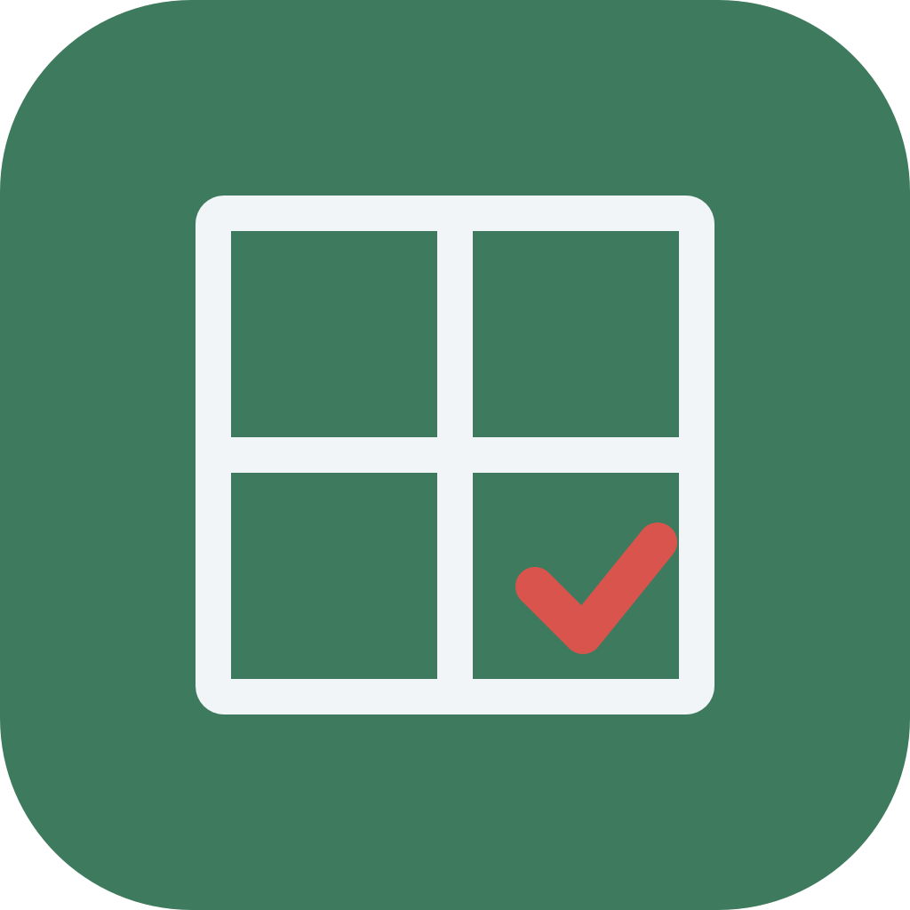
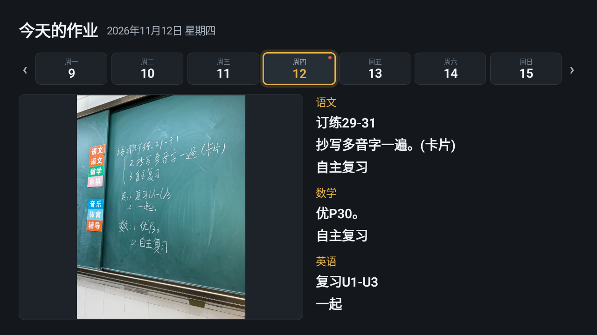
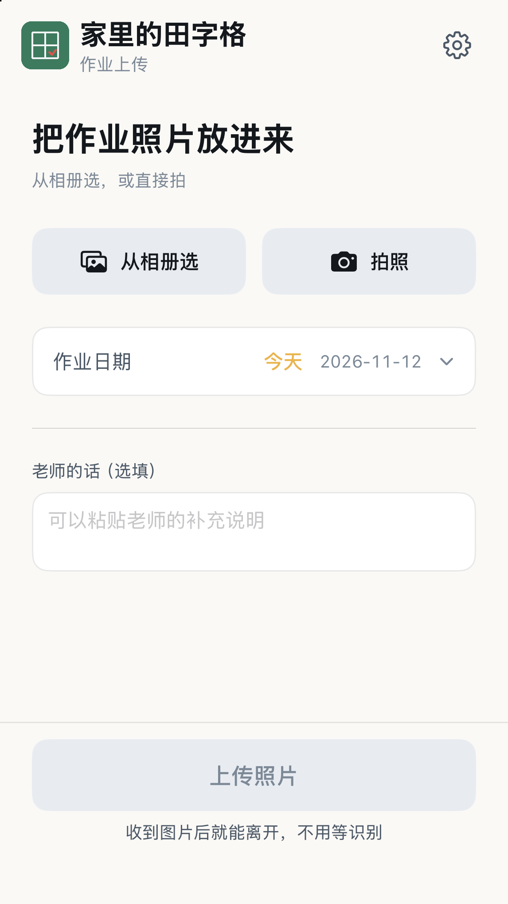
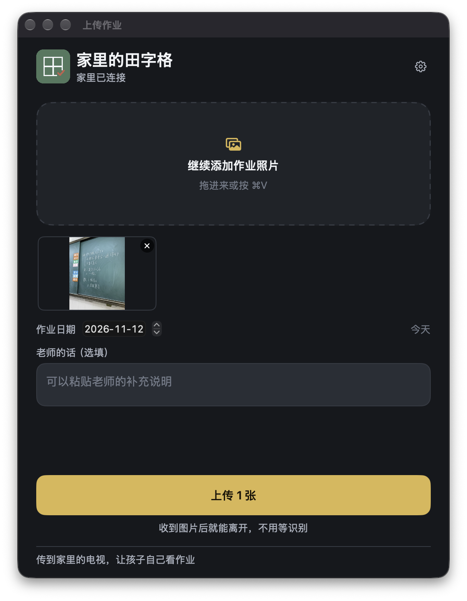
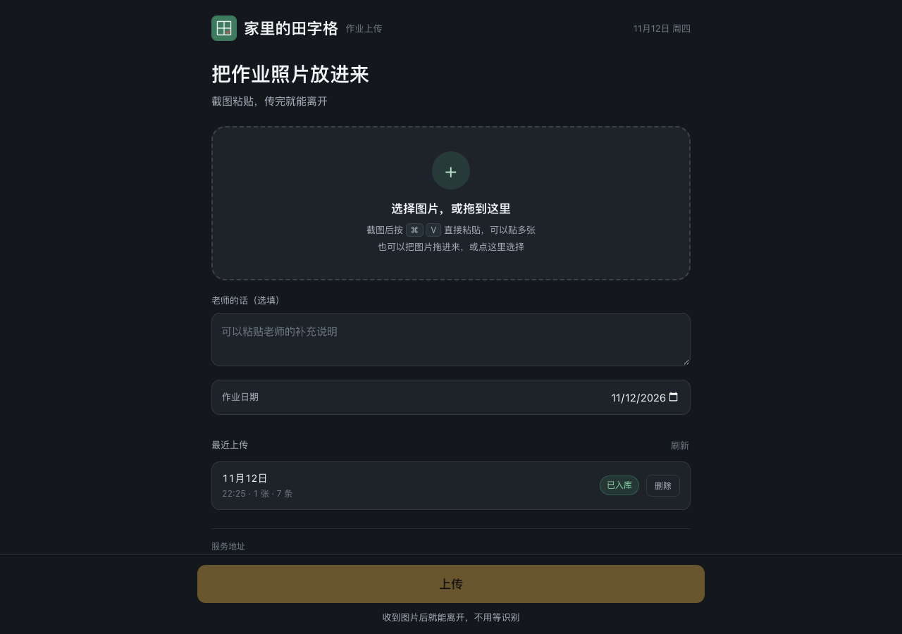
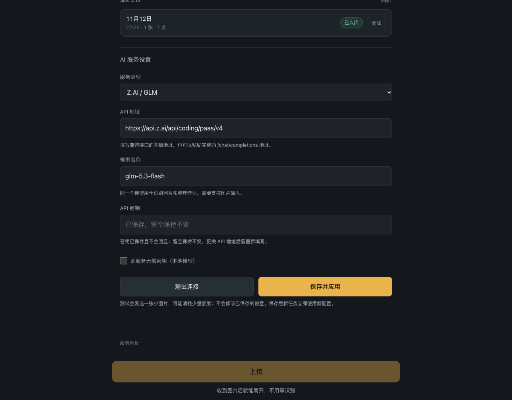

<p align="center">
  
</p>

<h1 align="center">Tianzige</h1>

<p align="center"><strong>Homework photos, from the class chat to the living room TV.</strong></p>

<p align="center">
  <a href="#getting-started">Getting started</a> ·
  <a href="deploy/README.md">NAS deployment</a> ·
  <a href="docs/06-构建环境.md">Build &amp; test</a> ·
  <a href="https://github.com/yangyao/tianzige-at-home/issues">Issues</a> ·
  <a href="README.md">简体中文</a>
</p>

<p align="center"><sub><i>tiánzìgé</i> (田字格) — the gridded notebook Chinese children use to practice handwriting. That's the name; the app is a homework viewer.</sub></p>

---

The teacher writes the day's homework on the blackboard, takes a photo, and posts it to the class chat. Your kid can't remember it, so they borrow an adult's phone, unlock it, open the chat, scroll back, and squint at a photo. Adults don't hand over their phones on demand.

This puts that photo on the TV instead. Upload it from a phone, a Mac, or a browser; it lands on your own NAS; the kid turns on the TV and reads it.

**Native Android TV · Native iPhone and Mac · Web upload · Self-hosted on your NAS · Bring your own AI**



*Running on the Android TV emulator. All subjects are expanded at once, so there's less remote-pressing.*

## Turn on the TV, see the homework

The home screen shows today's blackboard photo next to the homework for each subject. Arrow left and right to look at previous days; press OK to open the photo full-screen and check it yourself.

The photo lands on the NAS first and recognition happens in the background. Without AI configured the TV still shows the photos. Once you point it at a vision-capable model, the server reads the text and sorts it by subject.

## Snap on your phone, paste on your Mac

On iPhone you can pick from the library or shoot directly. On Mac you can drag photos in or paste a screenshot. Both let you set the homework date, attach the teacher's note, and upload several photos at once. The server accepts them and you can leave — no waiting for recognition.

| iPhone · Library and camera | Mac · Drag and paste |
| :---: | :---: |
|  |  |

*iPhone: simulator screenshot of the app area. Mac: the actual running window.*

## Upload from a browser too

The NAS also serves a web upload page — pick, drag, or paste photos, and check how recent uploads went. Works on a phone screen or a desktop browser.



## Bring your own AI

Expand "AI service settings" at the bottom of the web page, fill in the endpoint, model, and key, test the connection, and save. Any OpenAI-compatible Chat Completions endpoint that accepts images works; there's a preset for Z.AI / GLM. The model has to handle both reading images and organising text.

The key stays on the NAS and the API never sends it back. Leaving the field blank keeps the current key; changing the endpoint requires re-entering it. Endpoints that need no key can be marked separately.



Photos and the database live on your own NAS. When you use an external AI service, the images and text are sent to whatever you configured — what that provider does with them is up to them. [AI setup notes →](docs/07-AI配置.md) *(Chinese)*

## Getting started

You need a NAS running the Go service, an Android TV, and something that can reach the NAS to upload. It's built for a home LAN: there are no accounts and no authentication for internet exposure.

1. Start the service following the [NAS deployment notes](deploy/README.md) *(Chinese)* and check that `/api/health` responds.
2. Enter the NAS address in the TV's settings screen.
3. Install the iPhone or Mac app, or just open `/upload.html` on the NAS.
4. Configure a vision-capable model in "AI service settings", then upload a homework photo.

### Deploying on the NAS

The release bundle is a single static binary — no Go, Docker, SQLite library or tzdata needed at runtime.

```sh
uname -m                                   # aarch64 → arm64 bundle, x86_64 → amd64
mkdir -p ~/.local/share/tianzige-at-home
tar -xzf tianzige-nas-linux-arm64.tar.gz -C ~/.local/share/tianzige-at-home
cd ~/.local/share/tianzige-at-home
cp server.env.example server.env && chmod 600 server.env
# edit server.env: TIANZIGE_LISTEN=192.168.1.50:18086  (LAN address + free port)
sh nas-service.sh start
```

Then open `http://<nas-ip>:<port>/` and point all three clients at the same address. `status`, `stop` and `restart` are the same script. `curl http://<nas-ip>:<port>/api/health` should answer `ok:true`.

Without AI you'll see `ocr:unconfigured`. Photos still upload, get stored, and show on the TV — the app never invents text. To turn on recognition, put your vision endpoint, key and model in `server.env` and set `TIANZIGE_OCR=openai`; add `TIANZIGE_LLM=openai` to also sort by subject. Keys stay on the server with `chmod 600` and never enter Git.

To update: `stop`, back up `bin/homework-server`, replace the binary and `web/`, then `start`. Keep `data/` and `server.env`. To roll back, swap the old binary back in while stopped, and copy `data/` (database and photos) only when the service is down.

The bundle does not register a QPKG or enable boot-time startup; wire `start` into whatever boot mechanism the NAS already uses once you've confirmed it runs. Full notes: [deploy/README.md](deploy/README.md) *(Chinese)*.

The Apple clients ship with this household's NAS address preset; change it in settings for any other setup. The old default address migrates automatically and custom addresses are kept. There's no auto-discovery yet, so update the setting if the NAS address changes.

| Component | Minimum / toolchain | Notes |
| --- | --- | --- |
| Android TV | Android 8.0 / API 26; JDK 17, SDK 34 | Kotlin + Compose, native |
| iPhone | iOS 16; Xcode, XcodeGen | SwiftUI; installing on a device needs your own signing |
| Mac | macOS 13; Xcode, XcodeGen | SwiftUI menu bar app plus upload window |
| NAS | Verified on Linux arm64 | Go + SQLite, single static binary, no Docker |
| Web | Any modern browser | Plain HTML / CSS / JavaScript, served by the NAS |

## Build and test

From the repository root:

```sh
sh scripts/build-tv.sh
sh scripts/build-apple.sh
make -C services/homework-server test bundle
```

Artefacts land in `dist/`: the TV APK, a Mac ZIP, an unsigned iOS app and a standard IPA, plus a Linux arm64 NAS bundle. The IPA uses the `Payload/*.app` layout so an existing LiveContainer setup can import it; copying the file is not the same as installing or running it.

The TV script uses the locally installed SDK and a cached Gradle distribution, and runs offline by default — it downloads nothing. The Apple script uses the installed Xcode SDKs and does not fetch simulators. Building the NAS binary for amd64 needs Go 1.21+ already present; see [Build environment](docs/06-构建环境.md) *(Chinese)*.

Verified so far: Android TV emulator walkthrough; iOS and macOS builds with visual checks; upload and AI recognition against a real arm64 NAS; web layout at widths from 320 to 1280 px. TV unit tests and lint pass, and Go race tests pass. The iPhone IPA has been imported into LiveContainer and confirmed working after a packaging fix; the full on-device flow still needs ongoing verification.

On the NAS the service currently runs as a user-level daemon, not registered to start on boot. Automatic collection from the chat group is not implemented. [Acceptance notes →](docs/08-验收记录.md) *(Chinese)*

## Project layout

| Directory | Contents |
| --- | --- |
| `apps/tv-android/` | Android TV: photos, dates, homework |
| `apps/upload-ios/` | iPhone camera and library upload |
| `apps/upload-mac/` | Mac drag, paste and menu bar upload |
| `apps/upload-web/` | Web upload page and AI settings |
| `services/homework-server/` | Photo storage, recognition and sorting, SQLite, HTTP API |
| `deploy/` · `scripts/` | NAS management, packaging, build scripts |
| `design/` · `docs/` | Design sources, screenshots, protocol, verification notes |

The API contract lives in [OpenAPI](spec/openapi.yaml). `.private/`, runtime photos, the database, keys and build artefacts stay out of Git; the screenshots used here are kept separately in `docs/screenshots/`.

## Downloads

Installers are on the [GitHub Releases](https://github.com/yangyao/tianzige-at-home/releases) page. Pushing a tag like `v1.0.0` makes GitHub Actions build the TV, Apple and NAS packages, run the tests, then create a release with SHA-256 checksums. See [Release process](docs/11-发布版本.md) *(Chinese)*.

## License

Code is under the [MIT License](LICENSE). The screenshots are here to show the real interface; the homework shown in them is not distributed as app content. Third-party dependencies keep their own licenses.
