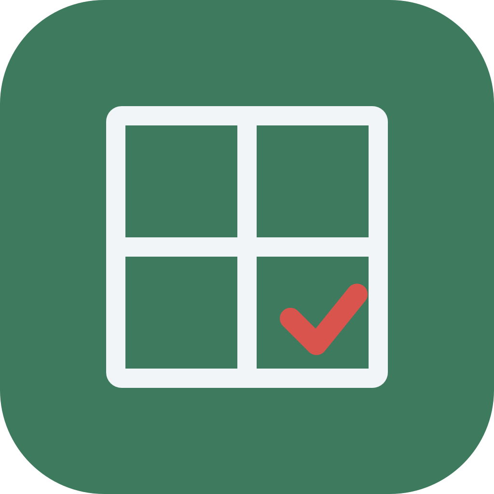
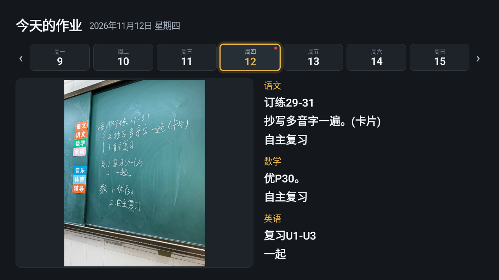
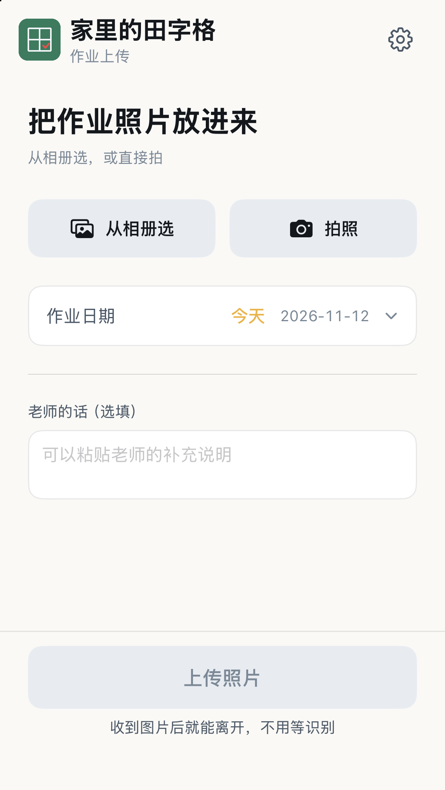
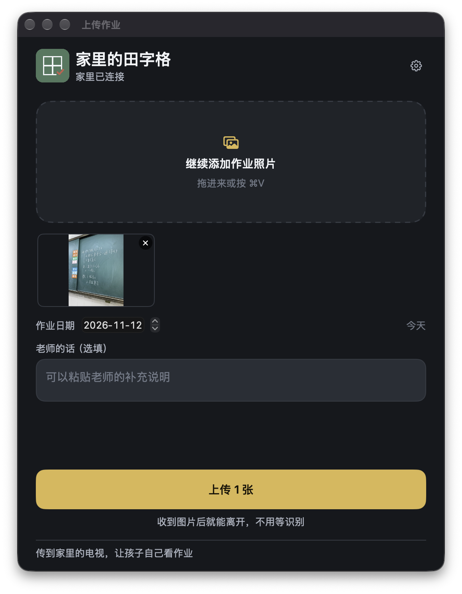
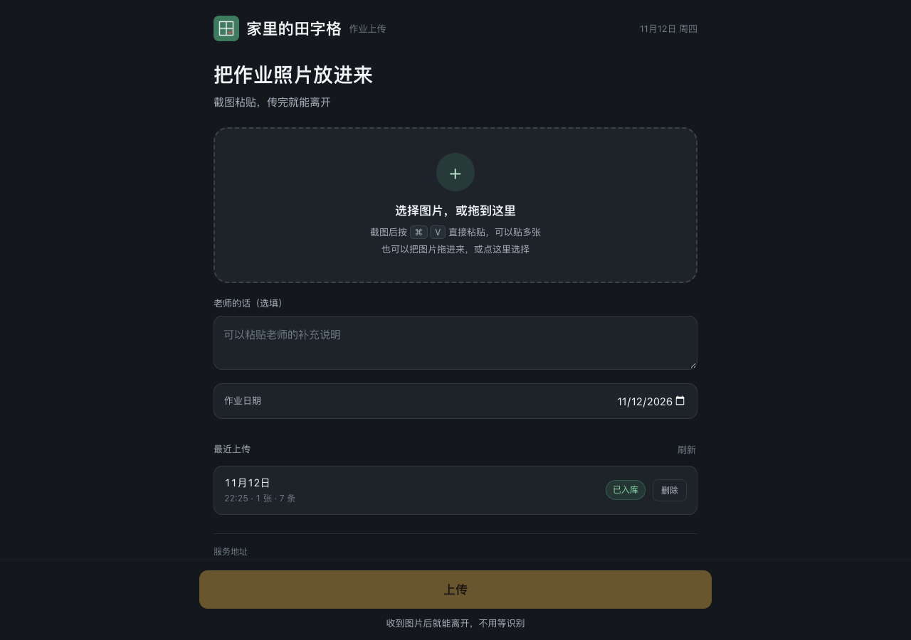
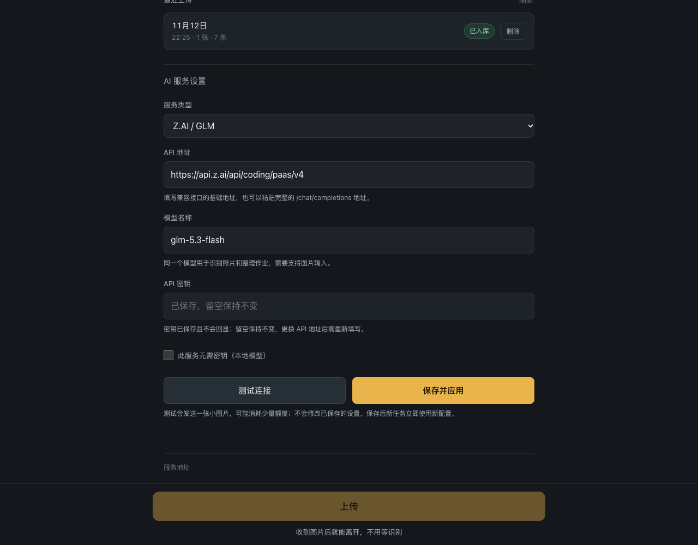

<p align="center">
  
</p>

<h1 align="center">家里的田字格</h1>

<p align="center"><strong>把作业照片传回家，孩子打开电视就能看。</strong></p>

<p align="center">
  <a href="#开始使用">开始使用</a> ·
  <a href="deploy/README.md">NAS 部署</a> ·
  <a href="docs/06-构建环境.md">构建与测试</a> ·
  <a href="https://github.com/yangyao/tianzige-at-home/issues">反馈问题</a>
</p>

老师把黑板上的作业拍照发到群里，家长用手机、Mac 或浏览器上传，孩子在客厅电视上就能看到原图和整理后的作业，不用再借大人的手机翻群消息。

**原生 Android TV · 原生 iPhone 与 Mac · 网页上传 · NAS 自托管 · 可切换 AI 服务**



*Android TV 模拟器实际运行画面。各科作业一起展开，减少遥控器切换。*

## 打开电视，就能看作业

首页直接展示当天的黑板照片和各科作业。切换日期可以回看前几天，选中照片可以打开大图核对。AI 整理的文字可能有误，原图始终保留。

照片先保存到 NAS，识别在后台继续。没有配置 AI 时，电视仍能查看照片；配置了支持图片输入的模型后，服务端再识别文字并整理学科。

## 手机拍一张，Mac 粘一下

iPhone 可以从相册选择或直接拍照；Mac 支持拖入图片和粘贴截图。两端都能指定作业日期、附上老师的补充说明，一次上传多张照片。服务端接收后即可离开上传页，不用等文字识别。

| iPhone · 相册与拍照 | Mac · 拖拽与截图粘贴 |
| :---: | :---: |
|  |  |

*iPhone 为 iOS 模拟器应用区域截图，Mac 为实际运行窗口。*

## 浏览器也能上传

NAS 同时提供网页上传页，支持选择、拖拽和粘贴图片，也可以查看最近上传的处理结果。手机屏幕和电脑浏览器均可使用。



## AI 服务可以自己换

在网页底部展开「AI 服务设置」，填写接口地址、模型与密钥，测试连接后保存即可生效。支持 OpenAI 兼容的 Chat Completions 视觉接口，并提供 Z.AI / GLM 配置选项；模型需要同时支持图片识别和文字整理。

密钥只保存在 NAS，接口不会回传密钥。留空可保留当前密钥，切换接口地址时需重新填写；本地无需密钥的服务可单独勾选。



照片与数据库保存在自己的 NAS。使用外部 AI 服务时，识别图片和文字会发送到所配置的服务；数据处理范围取决于该服务。[AI 配置说明 →](docs/07-AI配置.md)

## 开始使用

需要一台运行 Go 服务的 NAS、一台 Android TV，以及能访问 NAS 的上传设备。应用当前用于家庭局域网，未提供账号和公网访问鉴权。

1. 按 [NAS 部署说明](deploy/README.md) 启动服务，确认 `/api/health` 返回正常。
2. 在电视设置中填写 NAS 服务地址。
3. 安装 iPhone 或 Mac 上传端，也可直接打开 NAS 的 `/upload.html`。
4. 在网页「AI 服务设置」中配置支持视觉输入的模型，上传一张作业照片。

Apple 客户端当前预设本家庭的 NAS 地址；其他环境请在设置中修改。旧默认地址会自动迁移，用户自定义地址保留。目前尚未实现自动发现，NAS 地址变化时需更新设置。

| 组件 | 最低环境 / 构建工具 | 说明 |
| --- | --- | --- |
| Android TV | Android 8.0 / API 26；JDK 17、SDK 34 | Kotlin + Compose 原生应用 |
| iPhone | iOS 16；Xcode、XcodeGen | SwiftUI；实机安装需自己的签名或导入环境 |
| Mac | macOS 13；Xcode、XcodeGen | SwiftUI 菜单栏与上传窗口 |
| NAS | 已验证 Linux arm64 | Go + SQLite，静态二进制；不依赖 Docker |
| Web | 现代浏览器 | 原生 HTML / CSS / JavaScript，由 NAS 提供 |

## 构建与测试

在仓库根目录执行：

```sh
sh scripts/build-tv.sh
sh scripts/build-apple.sh
make -C services/homework-server test bundle
```

产物位于 `dist/`：电视 APK、Mac ZIP、iOS 未签名 App 与标准 IPA，以及 Linux arm64 NAS 部署包。IPA 采用 `Payload/*.app` 结构，可交给已有的 LiveContainer 环境导入；复制文件本身不代表已安装或运行。

电视构建脚本使用本机已安装的 SDK 与缓存的 Gradle，默认离线，不下载组件。Apple 构建使用已安装的 Xcode SDK，不下载模拟器。NAS 的 amd64 构建需要已有 Go 1.21+，详见 [构建环境](docs/06-构建环境.md)。

目前已完成 Android TV 模拟器验收、iOS / macOS 编译与界面检查、实际 arm64 NAS 的上传和 AI 识别，以及 Web 在 320–1280px 宽度下的排版检查。电视单元测试与 lint、Go race 测试均通过。iPhone IPA 已传入 LiveContainer，安装版本修正后用户确认可用；完整真机流程仍需持续验证。

NAS 当前为用户级常驻服务，尚未注册重启自动启动；自动从群聊采集图片也尚未实现。[验收记录 →](docs/08-验收记录.md)

## 项目结构

| 目录 | 内容 |
| --- | --- |
| `apps/tv-android/` | Android TV 原图、日期和作业展示 |
| `apps/upload-ios/` | iPhone 拍照与相册上传 |
| `apps/upload-mac/` | Mac 拖拽、粘贴与菜单栏上传 |
| `apps/upload-web/` | 网页上传和 AI 服务设置 |
| `services/homework-server/` | 图片落盘、识别分科、SQLite 与 HTTP API |
| `deploy/` · `scripts/` | NAS 管理、打包与构建脚本 |
| `design/` · `docs/` | 设计源文件、截图、协议和验证记录 |

接口定义见 [OpenAPI](spec/openapi.yaml)。`.private/`、运行时照片、数据库、密钥与构建产物不进入 Git；README 使用的截图单独保存在 `docs/screenshots/`。
